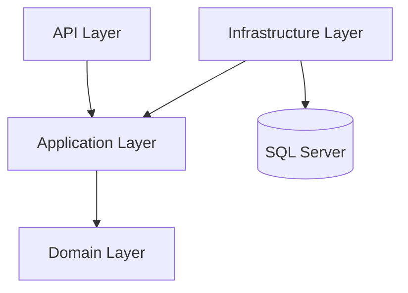

# Global E-Commerce Platform

<p align="center">
  <strong>Full-stack e-commerce solution with an ASP.NET Core Clean Architecture backend</strong>
</p>

<p align="center">
  
  
  
  
</p>

## Overview

A full-stack e-commerce application with an ASP.NET Core .NET 10 backend organized around Clean Architecture. The repository includes separate backend and frontend workspaces, backend unit and integration test projects, and a Postman collection.

## Backend architecture

The backend is separated into four layers:

| Layer | Responsibility |
| --- | --- |
| **Domain** | Core entities, enums, and value objects |
| **Application** | Use cases, DTOs, interfaces, validators, and application models |
| **Infrastructure** | Entity Framework Core, persistence, integrations, and background services |
| **API** | REST endpoints, middleware, and application startup |



## Repository structure

```text
.
├── backend/
│   ├── src/
│   │   ├── ECommerce.Domain/
│   │   ├── ECommerce.Application/
│   │   ├── ECommerce.Infrastructure/
│   │   └── ECommerce.API/
│   ├── tests/
│   │   ├── ECommerce.UnitTests/
│   │   └── ECommerce.IntegrationTests/
│   ├── CleanDb.sql
│   ├── ECommerce_Postman_Collection.json
│   └── BACKEND_ARCHITECTURE_GUIDE.md
├── frontend/
└── run-backend.bat
```

## Technology

- C# and .NET 10
- ASP.NET Core Web API
- Clean Architecture
- Entity Framework Core
- SQL Server
- Unit and integration test projects
- Angular and TypeScript frontend (see the frontend workspace manifest for exact package versions)

## Prerequisites

- .NET 10 SDK
- SQL Server
- Node.js and npm for frontend development

## Quick start — backend

From the repository root:

```powershell
cd backend
dotnet restore
dotnet test
dotnet run --project src/ECommerce.API
```

The project README documents Swagger at [http://localhost:5196](http://localhost:5196) and a health endpoint at [http://localhost:5196/health](http://localhost:5196/health). Confirm the actual URLs from the API launch output and configuration.

## Frontend

The Angular workspace is under `frontend/`.

```bash
cd frontend
npm install
npm start
```

Use the workspace's configured scripts and environment settings when connecting the frontend to the API.

## API testing

A Postman collection is included:

- [E-Commerce Postman collection](backend/ECommerce_Postman_Collection.json)
- [Backend architecture guide](backend/BACKEND_ARCHITECTURE_GUIDE.md)

## Database safety

Review `backend/CleanDb.sql` carefully before running it: database cleanup scripts can permanently delete data. Use a disposable development database and take a backup before any destructive database operation.

Never commit production connection strings, passwords, API keys, access tokens, or customer data.

## Testing

Run backend test suites:

```bash
cd backend
dotnet test
```

A previous version of this README reported 64 passing tests. Treat that as a historical report, not a current guarantee; run the command above to verify the current checkout.

## License

No license terms are stated here. Unless a license file is present and applicable, all rights remain with the copyright holder.
